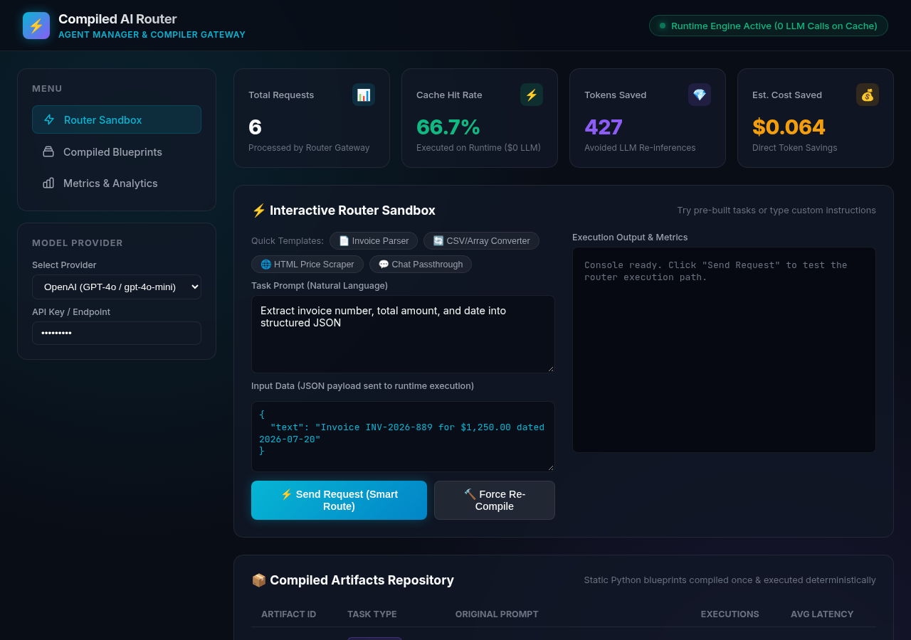
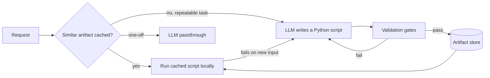

# Petra

Petra is a prototype gateway that turns repetitive LLM tasks into plain Python scripts. The first time it sees a task (for example "extract the total and date from this invoice"), it asks an LLM to write a small, deterministic script for it, validates that script, and caches it. Later requests of the same kind run the cached script locally instead of calling the LLM again. One-off requests still go straight to the LLM.

The idea: many production LLM calls do the same job over and over on differently shaped inputs. Paying for a model call (and waiting seconds for it) every time is wasteful if a 50-line script can do the job.


*Dashboard in demo mode (no API key). Numbers in demo mode are simulated and labelled as such.*

> **Status: prototype.** The compile → validate → cache → execute loop works end to end, including with a real LLM. Code execution is **not** strongly sandboxed yet (see [Security](#security)). Do not run it on untrusted input.

## How it works



1. **Routing.** A request (prompt + input JSON) is matched against cached artifacts with TF-IDF similarity on the prompt. Requests that don't look repeatable go to the LLM directly.
2. **Compilation.** The LLM is asked for a standard-library-only Python script that reads JSON on stdin and writes JSON on stdout.
3. **Validation.** Before caching, the script must pass: syntax check (AST), an import allowlist and forbidden-name check, an optional [Bandit](https://github.com/PyCQA/bandit) scan, a run on the sample input in a restricted subprocess, and, if the request includes held-out examples, a check that it produces the expected output for all of them. If a script fails validation, the error is sent back to the LLM and it gets up to 3 attempts.
4. **Execution and drift.** Cached scripts run in a fresh subprocess. If a cached script fails on a new input, Petra recompiles it.
5. **Measurement.** Every request records route, latency, tokens and cost. Results from real LLM calls are marked `measured: true`. Demo-mode estimates are marked `measured: false`.

## Measured so far

One run of the `measure` command (invoice extraction, 20 iterations) against a local model (Ollama `gemma4`) on a single machine, raw output in [`docs/measurement-local-gemma4.json`](docs/measurement-local-gemma4.json):

| | Average latency |
|---|---|
| LLM call (passthrough) | ~11.3 s |
| Cached script | ~51 ms |

The compile cost was recovered after about 7 executions. This is a single run on a small local model, not a benchmark. Cost savings against a hosted model have not been measured yet.

## Quick start

Requires Python 3.10+.

```bash
git clone https://github.com/elianlehoux/petra.git && cd petra
python3 -m venv .venv && source .venv/bin/activate
make setup && make build

make demo      # runs without an API key (simulated LLM)
make test      # unit + end-to-end tests
make run       # API + dashboard on http://127.0.0.1:8080
```

To use a real model, copy `.env.example` to `.env` and set `OPENAI_API_KEY`. Any OpenAI-compatible endpoint works through `LLM_BASE_URL`. For example, a local Ollama:

```bash
LLM_BASE_URL=http://localhost:11434/v1
LLM_MODEL=gemma4:latest
OPENAI_API_KEY=local
```

Docker: `make docker-build && make docker-run`.

## API

| Method | Path | Description |
|---|---|---|
| `POST` | `/route` | Route a request: run a cached script, compile a new one, or pass through to the LLM |
| `POST` | `/compile` | Force compilation for a prompt |
| `POST` | `/execute/{id}` | Run a specific artifact |
| `GET` | `/artifacts`, `/artifacts/{id}` | List or inspect compiled artifacts |
| `DELETE` | `/artifacts/{id}` | Delete an artifact |
| `GET` | `/metrics` | Aggregate metrics |
| `GET` | `/health` | Health check |

```bash
curl -X POST http://127.0.0.1:8080/route \
  -H "Content-Type: application/json" \
  -d '{"prompt": "Convert this CSV to JSON records", "input_data": {"csv_data": "name,age\nAna,30"}}'
```

The same operations are available from the CLI: `python -m compiled_ai_router.cli {route,compile,execute,list,metrics,serve,benchmark,measure,demo}`.

## Security

The static gates are defense in depth, not isolation. Today:

- **macOS:** scripts run under `sandbox-exec` (no network, writes limited to a temporary directory) plus CPU, time, file and process limits.
- **Linux and others:** only resource limits (including memory) are applied. File system and network are not confined.

Real isolation is the next phase. A WASM spike (`wasmtime` + CPython compiled to WASI) is documented in [`docs/wasm-sandbox-spike.md`](docs/wasm-sandbox-spike.md): isolation worked, but booting CPython inside WASM cost ~70 ms per run, about twice the current subprocess.

## Project layout

```
python/compiled_ai_router/   router, compiler, validation gates, executor, API, CLI
python/tests/                unit and end-to-end tests
ui/                          dashboard served by the API
docs/                        roadmap, research notes and WASM spike (in Spanish)
spike/                       WASM sandbox prototype and benchmarks
```

The Python package is still called `compiled_ai_router`, the project's earlier name.

## License

MIT. See [LICENSE](LICENSE).
