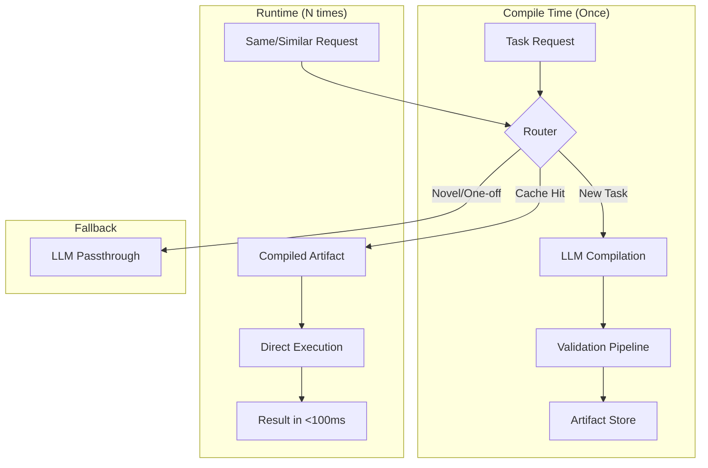

# Petra — intelligence that runs at the speed of code

> **Petra** convierte la probabilidad difusa de un LLM en código sólido y determinista: compila una tarea una vez y la ejecuta muchas, rápido y auditable. (El paquete Python todavía se importa como `compiled_ai_router` — rename pendiente en el roadmap.)

[](https://github.com/CompiledAI/router)
[](https://opensource.org/licenses/MIT)

**Compiled AI Router** transforms slow, expensive LLM calls into deterministic, local code executions. Instead of sending every request to an LLM, the router analyzes tasks and **compiles** repeatable patterns into local execution artifacts. You get the flexibility of GenAI with the reliability and cost-profile of traditional software.

> ⚠️ **Estado: prototipo.** El loop (compilar → cachear → ejecutar) funciona en modo `demo`, pero las métricas de performance/costo todavía **no están medidas** (ver nota en *Key Metrics*) y la ejecución **aún no corre en un sandbox real**. El plan para llevarlo a producto está en [`docs/ROADMAP.md`](docs/ROADMAP.md); el análisis del paradigma, en [`docs/investigacion-ia-compilada.md`](docs/investigacion-ia-compilada.md).

## Architecture



## Key Metrics (objetivo, aún no medido)

Estos son los números **objetivo**, alineados con lo que reporta la literatura del paradigma
(ver [investigación](docs/investigacion-ia-compilada.md)). **Todavía no están medidos en este
proyecto** — obtenerlos de verdad es la Fase 1 del [ROADMAP](docs/ROADMAP.md).

- **Cost**: órdenes de magnitud más barato que llamar al LLM en cada request (objetivo)
- **Latency**: mucho menor que el LLM para ejecuciones cacheadas (objetivo)
- **Breakeven**: el costo de compilación se amortiza tras unas ~17-18 ejecuciones repetidas

## Quick Start

1. **Clone repo**: `git clone <repo-url> && cd compiled-ai-router`
2. **Setup Env**: `cp .env.example .env` (Add your OPENAI_API_KEY)
3. **Install**: `make setup && make build`
4. **Demo**: `make demo` (works without API key)
5. **Run**: `make run` (starts API server)

### Demo Output Example
```text
$ make demo
Running demo showcase...
[Router] Request received: "Extract structured data from this invoice"
[Router] Pattern not found. Compiling via LLM... (Latency: 840ms)
[Router] Artifact generated and validated. Execution successful.
[Router] Request received: "Extract structured data from this invoice (new data)"
[Router] Cache Hit! Executing compiled artifact... (Latency: 4ms)
```

## API Reference

| Method | Path | Description | Example cURL |
|--------|------|-------------|--------------|
| `POST` | `/api/v1/process` | Processes a prompt and input payload, compiling if necessary. | `curl -X POST -H "Content-Type: application/json" -d '{"prompt":"...", "input_data":{}}' http://localhost:8080/api/v1/process` |
| `GET`  | `/api/v1/health` | Health check endpoint | `curl http://localhost:8080/api/v1/health` |
| `GET`  | `/api/v1/artifacts`| List compiled artifacts | `curl http://localhost:8080/api/v1/artifacts` |

## CLI Reference

| Command | Description | Example |
|---------|-------------|---------|
| `make setup` | Installs dependencies | `make setup` |
| `make build` | Builds engine and installs package | `make build` |
| `make run` | Starts the API Server | `make run` |
| `make test` | Runs the test suite | `make test` |
| `make benchmark` | Runs 100 iterations benchmark | `make benchmark` |

## Architecture Deep Dive

### Compilation Process
1. **Analysis**: Classifies the prompt (e.g., extraction, transformation).
2. **Code Generation**: Synthesizes a self-contained Python script to parse the input pattern.
3. **Artifact Creation**: Saves the executable logic to disk.

### Validation Pipeline
All generated code passes through validation gates before caching:
1. Syntax validation (AST)
2. Security static analysis (AST import **allowlist** + forbidden names/dunders)
2b. SAST with Bandit (optional — skipped if not installed)
3. Sandboxed test execution (subprocess + rlimits + isolated interpreter)
4. Output/semantic verification

> ⚠️ Estos gates son **defensa en profundidad, no una jaula**. El gate estático (allowlist)
> es la defensa principal; el executor con rlimits acota runaway (CPU/timeout) pero **no**
> aísla FS/red/memoria en macOS. El aislamiento real (WASM / microVM) es la Fase 2 del
> [ROADMAP](docs/ROADMAP.md).

## Performance Model

The amortized cost formula for the Router:
`Total Cost = (Cost_LLM_Compile * 1) + (Cost_Compute * N)`
For large N, the cost per request converges to O(1) standard compute cost.

## Configuration

| Environment Variable | Description | Default |
|----------------------|-------------|---------|
| `OPENAI_API_KEY`     | API key for LLM compilation | `null` |
| `LLM_MODEL`          | Model used for code generation | `gpt-4o-mini` |
| `ARTIFACT_DIR`       | Directory for saving artifacts | `./artifacts` |
| `API_PORT`           | Port for the API server | `8080` |

## Development
Contributions are welcome! Please ensure you pass tests (`make test`) and format your code before creating a Pull Request.

## License
MIT License. See [LICENSE](LICENSE) for more details.
